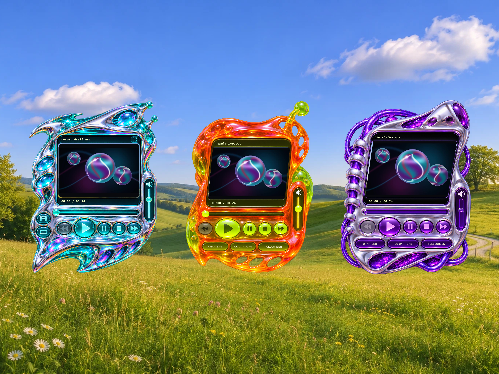

# Spriteware



[Download the project image](https://subtlegradient.github.io/spriteware-videojs-skins/images/spriteware-three-skins.jpg)

Illustrated player skins for Video.js v10. One shared player; artwork and layout supplied by theme manifests.

## Nebula Pop

Candy orange. Acid lime. Alien hardware. Nebula Pop turns a rendered gadget into a working video player, with image-based control states and native controls beneath the artwork.

**[Play the demo](https://subtlegradient.github.io/spriteware-videojs-skins/?skin=nebula)**

```sh
npm ci
npm run dev
```

```sh
npm test
npm run build
```

## BIOPOD

Ultraviolet glass and silver ribs, with a sculptural shell and oversized Play control.

**[Play BIOPOD](https://subtlegradient.github.io/spriteware-videojs-skins/?skin=biopod)**

## Liquid Orbit

Electric aqua and liquid chrome. An asymmetric spacecraft with a dominant Play jewel and a separate pause control.

**[Play Liquid Orbit](https://subtlegradient.github.io/spriteware-videojs-skins/?skin=liquid)**

## Controls

Play and Pause are separate buttons. Tab between controls; Enter or Space activates buttons. Timeline arrows seek five seconds, Home and End jump to either end, and Escape closes chapter selection. iPhone may use native fullscreen and hardware volume.

## Themes

`src/mount.js` contains the shared reusable player; `src/player.js` is only the demo adapter. Theme manifests in `src/themes/` map artwork and hit regions onto one coordinate system. Assets live in `public/themes/`. New themes swap artwork and geometry, not playback code.

No WebGL, canvas effects, autoplay, or duplicate mobile toolbar.

## Embed on your website

The player now has a scoped, per-instance API. It does not replace your heading, change your page title, inject the meadow wallpaper, or look up a global `#mount`. Existing children of the supplied host are preserved. The module imports only its scoped player stylesheet.

The package is **not published to npm**. From this checkout run `npm pack`, then install the resulting tarball in your Vite/Webpack application alongside Video.js:

```sh
npm install @videojs/html@10.4.0 /path/to/spriteware-videojs-skins-1.0.0.tgz
```

Use a client-side browser entry (not server rendering):

```js
import { mountSpriteware } from 'spriteware-videojs-skins';

const player = mountSpriteware(document.querySelector('.my-video'), {
  theme: 'liquid', // 'nebula' | 'biopod' | 'liquid'
  src: '/my-film.mp4',
  poster: '/my-poster.jpg',
  title: 'My film',
  captions: [{ src: '/captions.vtt', language: 'en', label: 'English' }],
  chapters: [{ time: 0, label: 'Opening' }, { time: 30, label: 'Next scene' }],
});

await player.ready; // true: decoded artwork; false: native-control fallback or disposed
// Start playback from a user gesture, not automatically after ready.
playButton.addEventListener('click', () => player.play().catch(console.error));
player.pause();
player.seek(20);
player.dispose(); // safe immediately after mount and safe to call twice
```

Use an empty element such as `<div class="my-video"></div>` or one with existing content. Give it the desired width. Each mount returns its own `root`, `video`, `player` (Video.js element), `theme`, `ready`, `play`, `pause`, `seek`, `sync`, and `dispose`. Media never autoplays. To change theme, dispose and mount again. You can operate the exposed `HTMLVideoElement` directly; normal media events refresh the controls.

`src` is required. Poster/title/tracks/chapters are optional. No captions means the captions button is disabled; no chapter list means chapter navigation is disabled. Use `chapters: 'auto'` explicitly for three equal segments, as in the demo. Titles are text, never HTML. `crossOrigin` can be `anonymous` or `use-credentials` when your media server requires it; remote caption tracks require an appropriate CORS configuration.

Artwork URLs are resolved from the installed package with standard `new URL(..., import.meta.url)` expressions. For a bundler without asset-URL handling, copy `public/themes/` to your site's public folder and set `assetBase` to its **parent directory** (for example `/spriteware-assets/` containing `themes/`). Keep its trailing slash. No demo MP4, wallpaper or poster is included in the packed package; supply your own media.

This is a file-video skin, not a Video.js 8 plugin or an HLS/DASH/DRM adapter. A browser bundler with CSS/asset imports is required; the source module is not a no-build script-tag bundle. Scoped light-DOM CSS avoids styling the surrounding page, but aggressive host `!important` styles or transformed/clipped containers can still interfere. Test within your site's actual layout and browsers.

### Integration verification

[Independent host fixture](https://subtlegradient.github.io/spriteware-videojs-skins/examples/embed.html) mounts two different themes with different media URLs, caller-authored chapters/captions and a dispose/recreate flow. Its heading, page font, background and unrelated button belong to the host, not the skin. Locally open `/examples/embed.html` after `npm run dev`.

```sh
npm test
npm run build
npx playwright install chromium
npm run test:browser
```

For an existing Chromium binary use `CHROMIUM_PATH=/path/to/chromium npm run test:browser`. The browser suite covers host isolation, independent playback/mute, supplied configuration, missing-track disabled states, keyboard popup exit, early disposal, recreation, fullscreen fallback ownership and the three original demos. Real Safari/iOS and native fullscreen still require device verification. Browser launch can be blocked in sandboxed environments; a successful build/Node test run is not proof the browser suite ran.

## License

[Apache License 2.0](LICENSE). See [NOTICE.md](NOTICE.md) for artwork and media provenance. Dependencies retain their own licenses.
